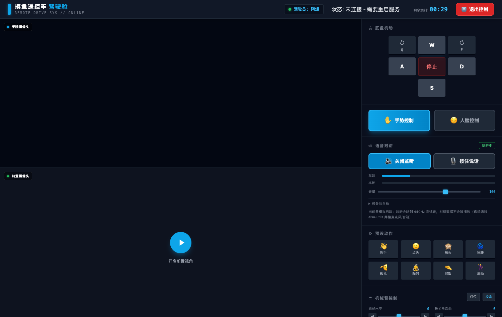
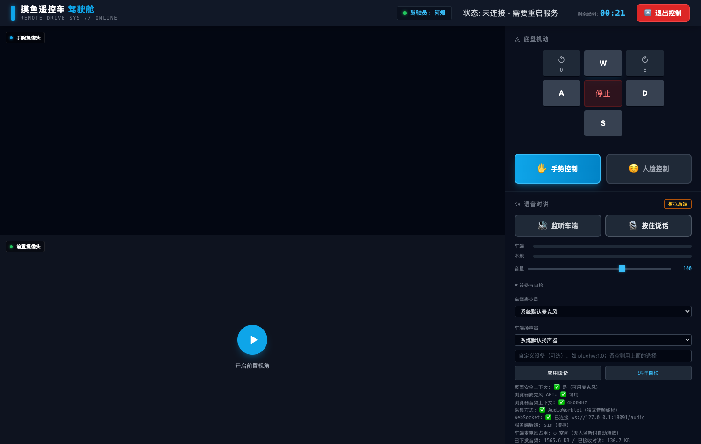

# 语音对讲（云摄像头 + 对讲机）

网页端两个功能，都在控制台右侧「语音对讲」面板里：

| 功能 | 方向 | 说明 |
| --- | --- | --- |
| **监听车端** | 车端麦克风 → 浏览器 | 像云摄像头点开声音，多个人可以同时听 |
| **按住说话** | 浏览器麦克风 → 车端扬声器 | 半双工对讲，同一时刻只有一个人能说（抢占式，谁先按谁说话） |

也可以按住键盘 `T` 说话（输入框聚焦时自动让位）。



*（上图为模拟后端下的实际界面：车端电平条跳动说明采集→下发链路已通）*

---

## 1. 硬件准备

LeKiwi 本身不带麦克风和喇叭，需要外接：

| 部件 | 建议 | 备注 |
| --- | --- | --- |
| 麦克风 | USB 免驱麦克风 / USB 声卡 + 3.5mm 小麦 | 树莓派板载无麦克风 |
| 扬声器 | USB 小音箱 / USB 声卡 + 有源音箱 | 别用无源喇叭，推不动 |
| 依赖 | `sudo apt install -y alsa-utils` | 提供 `arecord` / `aplay` |

先跑自检确认硬件就绪：

```bash
cd pi_client
./scripts/audio_selftest.sh            # 用默认设备
./scripts/audio_selftest.sh plughw:1,0 # 指定设备（设备号看 arecord -l）
```

自检会检查命令、枚举声卡、占端、录 3 秒、算电平、放回来。

---

## 2. 启动

```bash
cd pi_client
cp config/env.example .env      # 如已存在则跳过
python -m moyurobot.web.controller --port 8080
```

启动日志里会出现：

```
INFO:moyurobot.core.audio:音频对讲中枢已启动（后端=alsa, 16000Hz, 100ms/包）
INFO:moyurobot.web.audio_ws:音频对讲 WebSocket 已启动: ws://0.0.0.0:8081/audio
INFO:__main__:✓ 语音对讲已就绪
```

不开 MCP、只要网页时可以直接用；和 `--mcp-mode http` 也不冲突（端口分开：8080 网页 / 8081 音频 / 8000 MCP）。

**没有硬件也想先看效果**：用模拟后端，监听会听到 440Hz 测试音，对讲数据被丢弃。

```bash
AUDIO_BACKEND=sim python -m moyurobot.web.controller --port 8080
```

---

## 3. ⚠️ 最容易踩的坑：麦克风权限需要 HTTPS

浏览器只在**安全上下文**才给麦克风权限，也就是 `https://` 或 `http://localhost`。

用局域网 IP + `http://192.168.1.50:8080` 打开时：

- **监听车端**：✅ 正常（播放不需要权限）
- **按住说话**：❌ 拿不到麦克风，面板会提示"浏览器禁止在非安全上下文使用麦克风"

三个解法，按推荐度排序：

**A. 自签 HTTPS（最省事）**

```bash
./scripts/gen_self_signed_cert.sh 192.168.1.50
python -m moyurobot.web.controller --port 8443 \
    --ssl-cert certs/robot.crt --ssl-key certs/robot.key
# 访问 https://192.168.1.50:8443/ ，首次点"高级 → 继续前往"
```

**B. 内网穿透 / 反向代理加 HTTPS**（有域名时最舒服）
隧道只暴露 8080 时，音频的 8081 要一起暴露，然后指定公开地址：

```bash
AUDIO_WS_PUBLIC_URL=wss://robot.example.com/audio    # 网页和音频同域
```

网页和音频用了**两个不同的域名**（例如网页 `https://lerobot.mycodebro.cn/`，
音频 `https://lerobotwws.mycodebro.cn/`）时，就把音频那个域名填进去：

```bash
# config/default.json 的 audio.ws_public_url，或 pi_client/.env
AUDIO_WS_PUBLIC_URL=https://lerobotwws.mycodebro.cn/
```

地址写法很宽松，`public_url.py` 会统一规范化：

| 写法 | 实际使用 |
| --- | --- |
| `https://lerobotwws.mycodebro.cn/` | `wss://lerobotwws.mycodebro.cn/audio`（http/https 自动换成 ws/wss） |
| `wss://lerobotwws.mycodebro.cn` | 自动补 `/audio`，不会自作主张加 `:8081` |
| `wss://audio.example.com:9443/audio` | 显式端口 / 路径原样保留 |
| `wss://{host}/audio` | `{host}`/`{port}`/`{path}` 按当前请求替换 |
| 留空（用 `config/default.json` 的值） | — |
| `auto` / `none` / `-` | 强制回到「按当前访问地址推导」 |

验证是否生效（浏览器地址栏或 curl 都行）：

```bash
curl -s https://lerobot.mycodebro.cn/audio/info | python -m json.tool | grep -E 'ws_url|ws_public_url'
# ws_url 就是前端实际去连的地址；来源是 config 说明走的配置，
# 是 auto 说明没读到配置（检查是不是被别处的 AUDIO_WS_PUBLIC_URL 覆盖了）
```

> 反代侧记得把 `/audio` 一并转发（WebSocket 升级头 `Upgrade: websocket` 不能丢），
> 音频服务的路径校验要求请求路径以 `/audio` 开头。

**C. Chrome 临时白名单**（只适合自己调试）
`chrome://flags/#unsafely-treat-insecure-origin-as-secure` 里填 `http://192.168.1.50:8080`。

> 每台要用的手机/电脑都得单独处理，人多了就走 A 或 B。

---

## 4. 面板说明

| 元素 | 含义 |
| --- | --- |
| 徽标 | `未连接` / `已连接` / `监听中` / `对讲中` / `模拟后端`，优先级从高到低 |
| 监听车端 | 开关车端麦克风的下发；**关闭后 2 秒服务端自动释放麦克风**（不长期占用） |
| 按住说话 | 按下开始上传本地麦克风；松开即停并释放麦克风（浏览器录音标记会消失） |
| 车端 / 本地 电平条 | 车端由服务端 RMS 上报；本地是你自己麦克风的实时电平 |
| 音量 | 只影响本地播放增益（0–150%），不影响车端 |
| 设备与自检 | 切换车端麦克风/扬声器、运行自检看链路状态 |

**半双工**：有人说话时，所有人的本地播放会自动静音（服务端也停止下发），避免车端喇叭的声音被自己的麦克风收回去形成啸叫。

「设备与自检」展开后可切换设备并一键体检链路：



---

## 5. 配置项

`config/default.json` 的 `audio` 段，或同名环境变量（环境变量优先）：

| 环境变量 | 默认 | 说明 |
| --- | --- | --- |
| `AUDIO_ENABLED` | `true` | 总开关；也可用 `--no-audio` |
| `AUDIO_BACKEND` | `auto` | `auto`/`alsa`/`pulse`/`ffmpeg`/`sim` |
| `AUDIO_CAPTURE_DEVICE` | 空 | 空=系统默认；或 `plughw:1,0` |
| `AUDIO_PLAYBACK_DEVICE` | 空 | 同上 |
| `AUDIO_SAMPLE_RATE` | `16000` | 语音够用，32 KB/s |
| `AUDIO_CHUNK_MS` | `100` | 每包时长；调小降延迟、调大更抗抖动 |
| `AUDIO_MONITOR_GAIN` | `1.0` | 车端麦克风太小可调到 2–4 |
| `AUDIO_TALK_GAIN` | `1.0` | 网页说话声音太小可调大 |
| `AUDIO_WS_PORT` | `8081` | 音频 WebSocket 端口 |
| `AUDIO_WS_PUBLIC_URL` | 空 | 浏览器实际连的 ws 地址；反代/穿透/多域名时必填，写 `https://.../` 也会自动规范化。留空则用 `config/default.json` 的值，写 `auto`/`none`/`-` 强制自动推导 |
| `AUDIO_MAX_CLIENTS` | `8` | 同时监听人数上限 |
| `AUDIO_TOKEN_SECRET` | 空 | 连接令牌的签名密钥。签发与校验同进程，**默认不用配**；只有把音频服务拆成独立进程/容器时才需要两端配同一个 |
| `AUDIO_TOKEN_TTL` | `21600` | 连接令牌有效期（秒）；连不上时前端会自动换新令牌 |
| `SESSION_COOKIE_DOMAIN` | 空 | 仅在「旧页面不带令牌」时兜底：填父域（如 `.mycodebro.cn`）让 Cookie 跨子域共享；用 IP 访问时必须留空 |
| `SESSION_COOKIE_SECURE` | 空 | 置 `1` 给 Cookie 加 `Secure`（TLS 终止在反代上时 Flask 看不到 https，需要手动开） |

---

## 6. 架构与协议（二次开发用）

```
树莓派                                       浏览器
┌────────────────────────┐                 ┌──────────────────┐
│ IntercomHub (单例)      │  二进制 PCM 帧   │ audio_control.js │
│  ├ 采集线程 arecord     │ ──────────────▶ │  ├ 重采样 16k→48k │
│  ├ 多路广播给监听者      │                 │  └ AudioBuffer 排程 │
│  └ aplay 独占播放        │ ◀────────────── │  └ 麦克风采集 worklet│
└────────────────────────┘  二进制 PCM 帧   └──────────────────┘
        ▲                                        ▲
        │ WSGI 内部调用                            │ wss://host/audio?token=xxx
   controller.py                             令牌 + cookie 鉴权（控制者才能说话）
```

**身份是怎么过去的**：网页服务在渲染页面/`/audio/info` 时，把当前登录用户签成一个
短期令牌（HMAC-SHA256）拼进 ws 地址的查询串；音频服务验签即认人，不依赖 Cookie。
网页和音频是**两个域名**时这点很关键 —— 会话 Cookie 是 host-only 的、属于网页域名，
浏览器不会把它带到音频域名的 WebSocket 握手上，只靠 Cookie 会一直提示「未登录」。
握手时先验令牌、验不过再退回 Cookie（同域/局域网直连的老页面仍然能用）。
实现见 `moyurobot/audio_token.py`。

> 令牌会明文出现在 ws 地址里（`/audio?token=…`），反代/隧道的访问日志可能把它记下来 ——
> 所以只给 6 小时有效期，`/audio/info` 也带 `Cache-Control: no-store`。想更严就配
> `AUDIO_TOKEN_SECRET`（换个密钥即吊销全部旧令牌）并把 `AUDIO_TOKEN_TTL` 调小。

消息格式（同一连接：文本帧=控制，二进制帧=S16_LE 裸 PCM）：

```
浏览器 → 服务端:  {"type":"monitor","on":true}
                 {"type":"ptt","on":true}                     # 按住说话
                 {"type":"select","capture":"plughw:1,0"}      # 切换设备
                 {"type":"ping"}
服务端 → 浏览器:  {"type":"hello"} {"type":"state"} {"type":"error"} {"type":"pong"}
                 <二进制帧> = 车端麦克风 PCM（16kHz/单声道/S16_LE）
```

关键文件：

| 文件 | 职责 |
| --- | --- |
| `moyurobot/core/audio.py` | 后端探测、设备枚举、采集广播、PTT 独占、半双工闸门、RMS 统计 |
| `moyurobot/audio_token.py` | 连接令牌的签发与校验（HMAC-SHA256，只用标准库） |
| `moyurobot/web/audio_ws.py` | 独立端口的 asyncio WebSocket 服务、令牌/Cookie 鉴权、协议分发 |
| `moyurobot/web/controller.py` | `/audio/info` 探测接口、启动/停止音频服务、可选的 HTTPS |
| `web/static/audio_control.js` | 面板逻辑、PCM 重采样、播放排程、PTT 交互 |
| `web/static/audio_capture_worklet.js` | AudioWorklet 采集（独立音频线程，避免抢占 MediaPipe 的主线程） |

为什么音频不走 Flask 路由：WSGI 不擅长长连接 + 二进制流；`websockets` 已经是项目依赖，独立守护线程不加依赖、不影响 HTTP 服务稳定性，出问题只影响音频一块。

---

## 7. 排错

| 现象 | 原因 / 处理 |
| --- | --- |
| 徽标一直「未连接」 | 打开「设备与自检」，看 **最近断开** 的关闭码：`1006` = 握手就没成功（域名/反代这一层，见下两行）；有「未登录」文字 = 服务端没认到身份（见下面那行）。局域网直连则先查 8081 是否被防火墙拦、端口是否被占，可用 `AUDIO_WS_PORT` 换端口 |
| `1006` 且 `curl -i https://音频域名/audio` 返回 502/404 | 反代/隧道没把音频域名指到树莓派的 8081（或隧道客户端没跑）：域名要指向 **8081**，保留 `/audio` 路径，并透传 `Upgrade: websocket` + `Connection: upgrade` 头（有的隧道要显式开 WebSocket 支持） |
| 连上了但提示「未登录：请先进入控制台页面」 | 先等两秒 —— 前端会自己重新拉一次 `/audio/info` 换新令牌再连。仍不行就按顺序查：① `curl -s https://网页域名/audio/info` 里的 `logged_in` 是不是 `true`（`false` = 当前请求没登录态，回控制台重新进一次）；② 自检面板的「连接令牌」是否「已签发」；③ 页面是不是缓存里的旧 JS（硬刷新 Ctrl/Cmd+Shift+R）。都正常还连不上，再看服务端日志里那行「音频客户端接入 … 身份来源=token/cookie」 |
| 点监听没声音 | 看车端电平条是否跳动：跳动=链路通，检查车端音量 `alsamixer`；不动=麦克风没打开，看服务端日志 |
| 按住说话没反应 | 面板提示安全上下文问题 → 走第 3 节 HTTPS；或提示"控制权不在你手上" → 当前有别人占用会话 |
| 有回授啸叫 | 用耳机听；或把车端音量调低；半双工已尽量避免，物理距离太近仍会串 |
| 声音断续/延迟大 | `AUDIO_CHUNK_MS` 调小（50）降延迟；WiFi 不稳则调大（150–200）抗抖动 |
| 对讲时别人听不到车端 | 这是设计（半双工）：说的人说完松手即恢复 |

---

## 8. 自动化测试

无需任何声卡，覆盖协议、并发、半双工、上行字节数：

```bash
cd pi_client
PYTHONPATH=. python moyurobot/tests/test_audio_pipeline.py
```

26 项断言，全绿即为通过。

---

## 9. 已知取舍与后续

- **半双工**而非全双工：实现简单、天然抗啸叫。全双工要加 AEC（回声消除），浏览器侧已有 `echoCancellation`，但车端喇叭与麦克风的物理回授仍需硬件隔离。
- **延迟预算**：采集 100ms 分包 + 网络 ~20ms + 浏览器 80ms 缓冲 ≈ **200–300ms**，对讲可接受。
- **下一步可做 AI 语音对话**：现有链路已经打通"听到"和"说出"，加 ASR + TTS（可直接复用已配置的 `QWEN_API_KEY` / DashScope）即可让小车主动作答，再把这套接进 `mcp/server.py` 的两个工具（`listen_and_transcribe` / `speak`），AI 与网页就能共用同一套语音能力。
